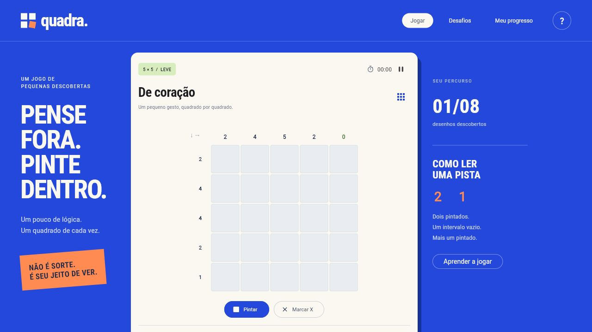

# Quadra

Nonogramas autorais: descubra desenhos usando as pistas de cada linha e coluna.

**[Jogar agora](https://gustapaz.github.io/quadra/)**



## Experiência

Oito desafios de 5×5, 7×7 e 9×9, seleção diária, tutorial, marcações, dicas, verificação, desfazer/refazer, pausa, conquistas e melhor tempo. Progresso salvo somente neste navegador. Não exige conta ou conexão com serviços de aplicação.

Teclado: Tab para navegar, setas entre células, Espaço/Enter para jogar, X para marcar, Ctrl+Z e Ctrl+Y para desfazer/refazer. Também aceita toque, clique, botão direito e toque longo.

## Stack e execução

Flutter 3.47.0, Dart 3.13.0 e SharedPreferences. Fontes e renderizador distribuídos localmente, sem CDN em tempo de execução.

```sh
flutter pub get --enforce-lockfile
flutter run -d chrome
flutter analyze
flutter test
flutter build web --release --base-href /quadra/ --no-web-resources-cdn --no-wasm-dry-run
node scripts/serve.mjs
```

O último comando serve o build em http://localhost:5184/quadra/.

## Direção visual

Um cartaz azul envolve uma folha de jogo clara: tipografia condensada, pistas junto ao tabuleiro e instruções nas margens. A composição muda para uma coluna no celular. Ao contrário da galeria Acervo, o foco é uma superfície interativa; o movimento comunica marcação e conclusão. Sem rolagem artificial, com foco visível, semântica do Flutter e respeito a movimento reduzido.

## Dados e privacidade

Todos os desafios são locais e autorais. O desafio diário seleciona um dos oito desenhos por data local, sem servidor. Não há login, telemetria, API ou banco. Limpar os dados do navegador apaga o progresso. A hospedagem estática usa GitHub Pages gratuito, sem faturamento.

## Validação

Oito testes automatizados cobrem solução única dos desafios, pistas, histórico, dicas, pausa, restauração, seleção diária, conclusão e layout em 320, 390, 768 e 1280 px. A revisão manual inclui teclado, conclusão, persistência e versão mobile. Detalhes em [docs/validacao.md](docs/validacao.md).

Aplicação interativa em canvas: metadados sociais e uma introdução HTML estão presentes, mas o tabuleiro não é uma página de conteúdo pré-renderizado. Não foram atribuídas notas de Lighthouse ou conformidade integral de acessibilidade.

## Licenças

Código MIT. Roboto e Roboto Condensed: Apache 2.0, textos em docs/. Dependências conservam suas próprias licenças.
